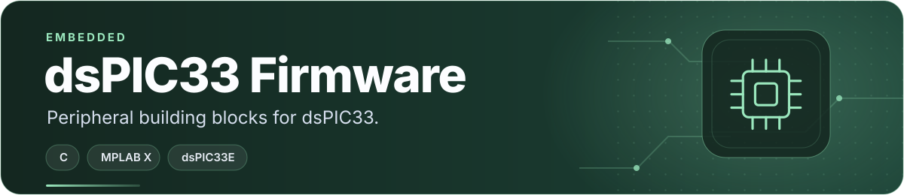

# 

Firmware for the dsPIC33EP256MC504. The project includes modules for ADC, GPIO, interrupts, DMA, and timers, with a simple application entry point.

[Quick start](#quick-start) · [Validation](#validation) · [Project layout](#project-layout) · [Reference](#reference)

## Quick start

Open the checkout as an existing project in MPLAB X. Select the `dsPIC33EP256MC504` target and configure the Microchip XC16 compiler and matching device pack before building the selected configuration.

## Validation

Build in MPLAB X, then test pin mappings, clocks, interrupts, and timing on the target board.

## Project layout

| Path | Purpose |
| --- | --- |
| [`main.c`](main.c) | Firmware entry point |
| [`system/peripherals/`](system/peripherals/) | ADC, GPIO, interrupt, and timer code |
| [`system/controllers/dma/`](system/controllers/dma/) | DMA controller modules |
| [`nbproject/`](nbproject/) | MPLAB X project configuration |

## Reference

Read the [project reference](README.reference.md) for detailed examples, configuration, and original notes.
